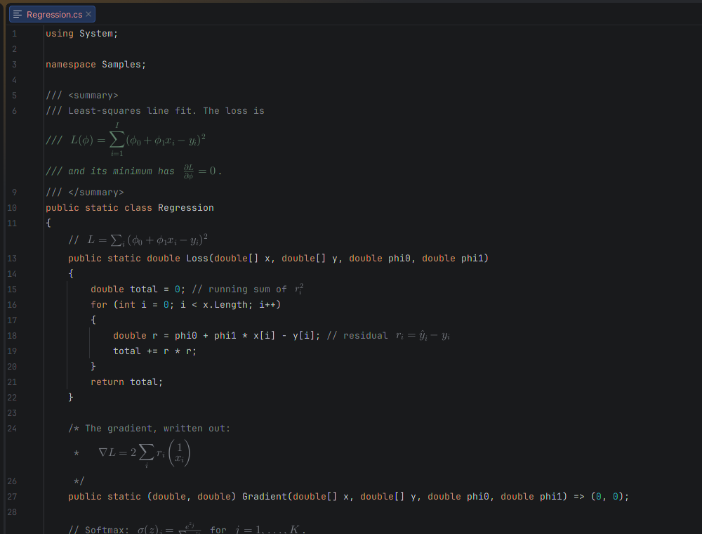

# LaTeX Comments

A JetBrains IDE plugin that shows LaTeX maths in code comments as real formulas, right in the editor.
Copy an equation from a book into a comment and read it the way the book prints it.



## What it does

- `$...$` and `\(...\)` inline, `$$...$$` and `\[...\]` display maths, in line comments, block comments and
  documentation comments (`///`, `/** */`, Python docstrings).
- The line under the caret shows the raw LaTeX, so editing is as easy as before.
- Hover over a formula for a larger preview. In Java and Kotlin, formulas also show in Quick Documentation.
- Works in C#, Java, Kotlin, C and C++, Python, JavaScript and TypeScript, Go, Rust, F#, Scala, Swift, R, Julia,
  Lua, SQL, MATLAB and more.
- A mistake in the LaTeX shows as a short note, never an error dialog. Prices like "$5 and $10" are left alone.
- Sharp on scaled screens, in the comment colour of your light or dark theme.

## Requirements

Rider 2026.1 or newer, or any other JetBrains IDE 2026.1 or newer.

## Install

Settings → Plugins → ⚙ → Install Plugin from Disk… → pick `latexcomments-<version>.zip` (from the CI build, or
`./gradlew buildPlugin` → `build/distributions/`).

## Use

```csharp
// The loss: $L = \sum_i (\phi_0 + \phi_1 x_i - y_i)^2$
double r = phi0 + phi1 * x - y; // residual $r_i = \hat{y}_i - y_i$
```

Turn it on or off with View → Render LaTeX in Comments (also in the editor's right-click menu). Formula size and
other options: Settings → Tools → LaTeX Comments. More: [user guide](docs/USER-GUIDE.md).

## Credits

Written by Jacob Goodchild. MIT licence. Formulas are drawn by [JLaTeXMath](https://github.com/opencollab/jlatexmath)
(GPL 2 with the classpath exception) with its Computer Modern and AMS fonts. Details:
[THIRD-PARTY-NOTICES.md](THIRD-PARTY-NOTICES.md).
